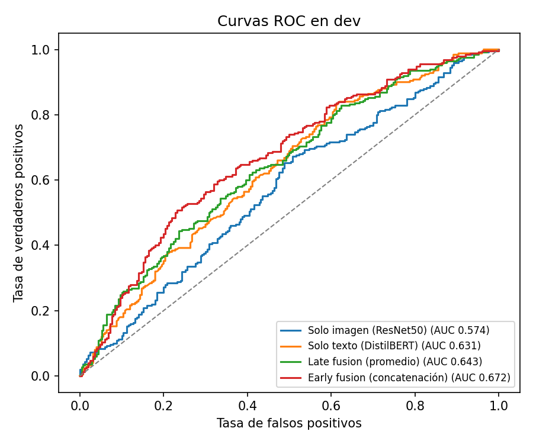
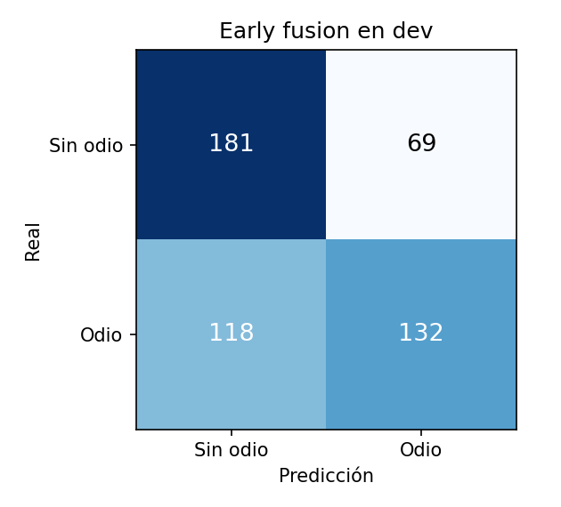

# Clasificación multimodal de memes con discurso de odio

Modelo de deep learning que decide si un meme contiene discurso de odio usando la imagen y el texto a la vez. Usa el dataset Hateful Memes (8 500 memes de entrenamiento y 500 de validación, etiquetados como 0 sin odio y 1 con odio).

En un meme el odio casi nunca está en una sola parte. Una foto neutral con un texto neutral puede ser ofensiva cuando se combinan, y el dataset se armó a propósito con casos así. Por eso el proyecto compara qué tan lejos llega cada modalidad sola y cuánto se gana al fusionarlas.

## Resultados

Evaluación en `dev.jsonl` (500 memes, 250 con odio). Ese split no se usó para entrenar ni para elegir hiperparámetros.

| Modelo | Accuracy | Precision | Recall | F1 | ROC-AUC |
|---|---|---|---|---|---|
| Solo imagen (ResNet50) | 0.542 | 0.527 | 0.816 | 0.640 | 0.574 |
| Solo texto (DistilBERT) | 0.580 | 0.608 | 0.452 | 0.518 | 0.631 |
| Late fusion (promedio de probabilidades) | 0.590 | 0.575 | 0.688 | 0.627 | 0.643 |
| **Early fusion (concatenación)** | **0.626** | **0.657** | **0.528** | **0.585** | **0.672** |

<p>
  
  
</p>

Lo que muestran los números:

- La imagen sola apenas supera al azar (ROC-AUC 0,57). Su F1 alto es engañoso: el umbral elegido la lleva a marcar casi todo como odio, por eso tiene recall 0,82 y precisión 0,53.
- El texto solo rinde mejor que la imagen, pero se queda corto porque muchos textos son inofensivos sin la foto.
- La fusión temprana es el mejor modelo en ROC-AUC y accuracy. Combinar los vectores antes de clasificar deja que la red aprenda interacciones entre imagen y texto, y eso no se logra promediando dos modelos separados (late fusion).
- El modelo es conservador: cuando dice "odio" acierta el 66 % de las veces, pero deja pasar casi la mitad de los memes con odio (118 de 250). Bajar el umbral sube el recall a cambio de más falsas alarmas.

Como referencia, el paper que presentó el dataset (Kiela et al., 2020, *The Hateful Memes Challenge*) reporta alrededor de 0,66 de ROC-AUC para su modelo de concatenación con BERT y 0,83 para personas. Superar eso de forma clara requiere modelos multimodales preentrenados juntos, como CLIP o ViLBERT.

## Cómo funciona

```
imagen ──> ResNet50 congelada ──> vector de 2048 ──┐
                                                   ├─> LayerNorm + concatenación (2816) ─> MLP ─> probabilidad de odio
texto  ──> DistilBERT congelado ──> vector de 768 ─┘
```

1. **Extracción de características** (`src/extract_features.py`). ResNet50 preentrenada en ImageNet, sin su capa final, y DistilBERT con mean pooling sobre los tokens. Las dos redes están congeladas, así que los embeddings se calculan una sola vez y se guardan en disco. Con eso el entrenamiento pasa de horas a segundos por época.
2. **Entrenamiento** (`src/train.py`). Una red MLP de dos capas ocultas (512 y 256) con dropout. Se separa un 10 % de train para validación de forma estratificada. La pérdida es `BCEWithLogitsLoss` con `pos_weight` para compensar que hay menos memes de odio, el optimizador es AdamW con weight decay y hay early stopping según el ROC-AUC de validación. El umbral de decisión de cada modelo se elige en validación maximizando F1.
3. **Evaluación** (`src/evaluate.py`). Calcula las métricas en dev para los cuatro modelos y genera las curvas ROC y la matriz de confusión.

Cada modalidad se normaliza con LayerNorm antes de concatenar. Los vectores de ResNet50 y DistilBERT tienen escalas muy distintas, y sin esa normalización la red tiende a ignorar uno de los dos.

## Estructura

```
src/
  config.py               rutas, hardware (CUDA, MPS o CPU) e hiperparámetros
  dataset.py              lectura de los .jsonl y de los embeddings guardados
  features/
    vision_extractor.py   ResNet50 -> 2048
    text_extractor.py     DistilBERT -> 768
  models/fusion_mlp.py    clasificador en modo imagen, texto o fusion
  extract_features.py     paso 1
  train.py                paso 2
  evaluate.py             paso 3
  predict.py              clasificar un meme nuevo
notebooks/
  entrenamiento_colab.ipynb   pipeline completo en Google Colab con GPU
results/                  métricas y gráficas de la última corrida
```

## Cómo correrlo

El dataset no está en el repositorio porque su licencia no permite redistribuirlo. Hay que conseguir Hateful Memes y dejar `train.jsonl`, `dev.jsonl` y la carpeta `img/` en `data/raw/data/` (o indicar otra ruta con la variable `MEME_DATA_DIR`).

**En Google Colab** (lo más rápido): abrir `notebooks/entrenamiento_colab.ipynb`, elegir GPU y ejecutar todo. Con una T4 tarda unos 15 minutos.

**En local:**

```bash
pip install -r requirements.txt
python -m src.extract_features --splits train dev
python -m src.train
python -m src.evaluate
python -m src.predict --image ruta/al/meme.png --text "texto del meme"
```

El código detecta solo si hay GPU NVIDIA (CUDA), Apple Silicon (MPS) o solo CPU.

## Qué probaría después

- Reemplazar ResNet50 y DistilBERT por CLIP, que fue entrenado con pares de imagen y texto y suele rendir bastante mejor en este dataset.
- Hacer fine-tuning de las últimas capas de los extractores en vez de dejarlos congelados.
- Probar fusión con atención cruzada entre los tokens del texto y las regiones de la imagen.

## Origen

Empezó como proyecto final de la materia Inteligencia Artificial (8.º semestre de Ingeniería Informática, UCAB). El proyecto se canceló en la materia y lo terminé por mi cuenta: extracción real de texto por lotes, embeddings cacheados, comparación entre modalidades y evaluación completa.
